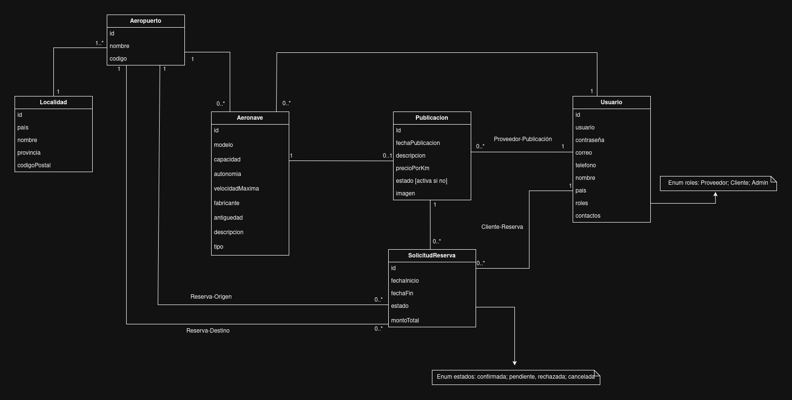

# Propuesta TP DSW

## Grupo

### Integrantes

| Legajo | Nombre |
| :--- | :--- |
| 52060 | Celeste Albuerne |
| 52308 | Franco Rodriguez |

### Repositorios

- [Frontend](https://github.com/celealbuerne/Frontend-app)
- [Backend](https://github.com/celealbuerne/Backend-app)

## Tema

### Descripción

AeroLux es una plataforma que conecta dueños de aeronaves con clientes exclusivos y gestiona todo el proceso: desde pedir presupuestos y enviar cotizaciones hasta reservar y pagar de forma segura.

### Modelo

[Ver el diagrama en draw.io](https://app.diagrams.net/#G1nMqtIMqy8IliIgLf5FR4Eqx7YcsVLK-M#%7B%22pageId%22%3A%22B5eMvQEZjcl8MpkFTvKB%22%7D)

### Alcance Funcional

#### Alcance Mínimo

##### Regularidad

| Req | Detalle |
| :--- | :--- |
| **CRUD simple** | 1. CRUD Localidad 2. CRUD Usuario |
| **CRUD dependiente** | 1. CRUD Aeropuerto {depende de} CRUD Localidad 2. CRUD Aeronave {depende de} CRUD Usuario |
| **Listado + detalle** | 1. Listado de Publicaciones filtrado por precio, muestra precio, descripción, modelo de aeronave, capacidad, autonomía y velocidad máxima => detalle CRUD Publicación 2. Listado de Aeropuertos filtrado por nombre, código y/o localidad, muestra nombre, código y localidad => detalle CRUD Aeropuerto |
| **CUU/Epic** | 1. Realizar Publicación 2. Realizar Solicitud de Reserva |

##### Adicionales para Aprobación

| Req | Detalle |
| :--- | :--- |
| **CRUD completo** | 1. CRUD Aeronave 2. CRUD Proveedor 3. CRUD Cliente 4. CRUD Localidad 5. CRUD Aeropuerto 6. CRUD Reseña |
| **CUU/Epic** | 1. Realizar Publicación 2. Realizar Solicitud de Reserva |
| **Listado + detalle** | 1. Listado de Solicitudes de Reserva filtrado por estado, muestra para una determinada aeronave las reservas registradas en ese estado => detalle CRUD Solicitud de Reserva |

#### Alcance Adicional Voluntario

| Req | Detalle |
| :--- | :--- |
| **Listado + detalle** | 1. Listado de Publicaciones filtrado por origen, muestra los datos completos de la publicación y la información del aeropuerto de origen => detalle CRUD Publicación |
| **CUU/Epic** | 1. Cancelar Reserva |
| **Otros** | 1. Notificación por mail al proveedor al recibir una Solicitud de Reserva 2. Recordatorio de reserva por mail al cliente |
