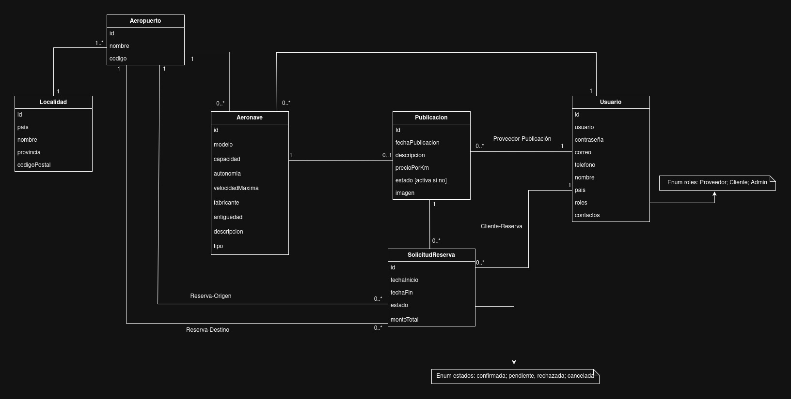

# Propuesta TP DSW

## Grupo

### Integrantes

* 52060 \- Celeste Albuerne   
* 52308 \- Franco Rodriguez  

### Repositorios

* [Frontend](https://github.com/celealbuerne/Frontend-app)
* [Backend](https://github.com/celealbuerne/Backend-app)

## Tema

### Descripción

Es una plataforma que conecta dueños de aeronaves con clientes exclusivos, gestionando todo el proceso: desde pedir presupuestos y enviar cotizaciones hasta reservar y pagar de forma segura.

### Modelo

[link](https://drive.google.com/file/d/1nMqtIMqy8IliIgLf5FR4Eqx7YcsVLK-M/view?usp=sharing)

## Alcance Funcional

### Alcance AD 

| Req | Detalle |
| :--- | :--- |
| **CRUD Simple** | <ul><li>- [ ] CRUD Localidad</li><li>- [ ] CRUD Usuario</li> |
| **CRUD Dependiente** | <ul><li>- [ ] CRUD Aeropuerto {Depende de} CRUD Localidad</li><li>- [ ] CRUD Aeronave {Depende de} CRUD Usuario</li></ul> |
| **Listado + Detalle** | <ul><li>- [ ] **Listado de publicaciones filtrado por precio:** Muestra datos completos de la publicación (precio, descripción, modelo de aeronave, capacidad, autonomía, velocidadMáxima) $\Rightarrow$ CRUD Publicación</li><li>- [ ] **Listado de SolicitudReserva filtradas por estado:** Muestra para una determinada aeronave todas las reservas registradas en un estado específico.</li></ul> |
| **CUU/Epic** | <ul><li>- [ ] Realizar una Publicación</li><li>- [ ] Realizar una Solicitud de Reserva</li></ul> |

### ### Alcance Adicional Voluntario

| Req | Detalle |
| :--- | :--- |
| **CRUD Completo** | <ul><li>- [ ] CRUD Aeronave</li><li>- [ ] CRUD Proveedor</li><li>- [ ] CRUD Cliente</li><li>- [ ] CRUD Localidad</li><li>- [ ] CRUD Aeropuerto</li><li>- [ ] CRUD Reseña</li></ul> |
| **CUU/Epic** | <ul><li>- [ ] Realizar una Publicación</li><li>- [ ] Realizar una Solicitud Reserva</li></ul> |

---

| Req | Detalle |
| :--- | :--- |
| **Listados** | <ul><li>- [ ] **Listado de publicaciones filtrado por origen:** Datos completos de publicación e información del aeropuerto de origen $\Rightarrow$ CRUD Publicación</li></ul> |
| **CUU/Epic** | <ul><li>- [ ] Realizar una Reseña</li><li>- [ ] Cancelar Reserva</li></ul> |
| **Otros** | <ul><li>- [ ] Notificación por mail al proveedor al recibir solicitud de Reserva.</li><li>- [ ] Envío de recordatorio de reserva por mail al cliente.</li></ul> |

